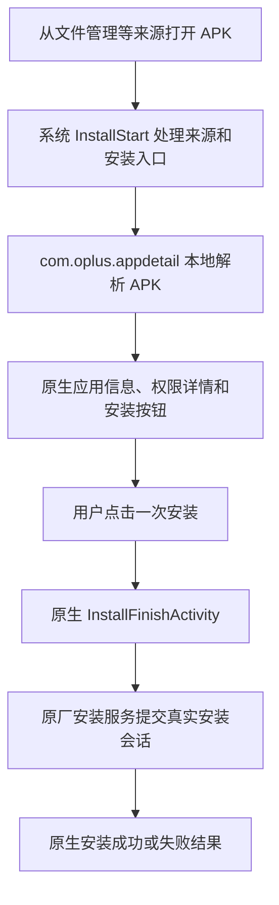

# ColorOS17安装器净化

适用于 Vector 的应用安装器净化模块，保留 `com.oplus.appdetail` 原生全屏安装界面，精简扫描、广告、更新提醒和重复确认。

- 保留应用信息、权限数量及原生权限详情。
- 只需一次“安装”确认，完成后显示原生安装结果。
- 同一模块根据安装器版本自动选择规则，桌面入口隐藏。

## 实现原理

模块使用 Vector 提供的现代 libxposed API 102，在安装器进程加载后拦截指定 Java 方法，调整页面状态和可选功能的调用。实现分为应用安装器前端和系统安装入口两部分，不需要重签或替换原厂 APK，也不修改 `system_server`。



### 1. 按安装器版本选择规则

`Compatibility` 读取目标应用的版本码，`Profile.select()` 为 51762 和 52302 选择各自的类名、方法签名及回调依赖。两版存在混淆名称和参数差异，因此不能直接套用同一组方法名。

前端在启用拦截前会解析并核对所需类、方法参数和返回类型；准备失败时，撤销已经注册的前端钩子，保留原行为。对目标方法和指定调用者执行去优化，避免已编译代码中的方法内联绕过钩子。`profile.json` 是规则来源，`verify_profile.py` 可对照本地原厂 APK 的 DEX 校验并生成 `Profile.java`。

### 2. 跳过厂商扫描与失败提示

`InstallerHook` 在预加载及引导配置入口提供本地的精简 `GuideResult`，关闭可选验证、扫描计时和提示配置，减少对远端引导结果的依赖。APK 的实际暂存、解析仍由原厂流程处理。

在 `RiskScanViewModel` 的扫描启动位置，模块不执行原扫描任务，而是向原生界面的状态观察者写入可继续渲染的完成态。随后将扫描内容区替换为权限摘要，并阻止无扫描失败卡片、重复提示及完成页附带提示的生成或显示。这个完成态用于页面流转，**不代表 APK 已通过安全检测**。

### 3. 保留原生页面，只确认一次

安装确认使用原厂 `EnhanceGuardFragment`、`HeaderAppInfoView` 和 `GuideBottomView`。模块将底部数据收敛为一个“安装”按钮，沿用原厂安装点击监听和导航；同时拦截扫描前按钮的延迟刷新，避免页面又变回“继续安装／取消安装”。

用户点击后，模块跳过可选的风险对话框，衔接原厂导航和已有安装任务，进入 `InstallFinishActivity`。实际安装由原厂安装服务提交会话，完成页显示系统返回的真实结果。

`NativeRouter` 处理底层 `com.android.packageinstaller` 的解耦入口：仅在支持的安装器版本和安装分支中，将功能开关导致的回退状态 1、11 调整为原生入口状态 0，使前端能接管完整流程，避免返回另一套扫描及确认页面。其他返回状态和卸载分支保持原语义。

### 4. 本地权限展示

`PermissionPanel` 优先读取原厂解析结果中的 `ExtJumpParam.getAppRequirePermissions()`；缺少该字段时，通过 `PackageManager.getPackageArchiveInfo(..., GET_PERMISSIONS)` 从 APK 本地读取权限元数据。若无法读取，则隐藏权限区域，避免把未知数据显示为“0 项权限”。

模块调用对应版本的原厂权限分类工具，生成权限总数和敏感权限数量，并复用原生视图展示。点击后，把本地权限数组传入原厂 `PermissionActivity`，按敏感权限、常规权限展示名称和用途说明。这个过程不启动风险扫描，也不申请或授予权限。

### 5. 广告、更新与正常安装的边界

模块在 `RecommendManager`、推荐展示和更新提醒入口中断可选调用，在结果页清空推荐内容、关闭商店引导和深度检测推广。处理结果页时仍保留原有状态记账；5.17 的卡片观察值是单个 `CardDto`，5.23 是 `List<CardDto>`，两版均使用其支持的 `null` 清空，避免类型转换错误。

厂商风险扫描及对应提示会被跳过。Android 系统签名校验、来源授权、安装会话校验和真实安装错误仍由系统处理；模块不会自动点击安装、伪造安装成功，也不能解决新旧 APK 签名不一致导致的升级失败。

| 源码 | 职责 |
| --- | --- |
| [InstallerHook.java](src/java/cn/lzy/gt7p/installerclean/InstallerHook.java) | 前端钩子、扫描状态、原生按钮、推荐和提示处理 |
| [NativeRouter.java](src/java/cn/lzy/gt7p/installerclean/NativeRouter.java) | 底层原生安装入口衔接 |
| [PermissionPanel.java](src/java/cn/lzy/gt7p/installerclean/PermissionPanel.java) | 本地权限摘要及原生详情页 |
| [profile.json](profile.json) | 两版安装器的目标方法和依赖规则 |

## 支持版本

| 应用安装器 | 验证情况 |
| --- | --- |
| 5.17.62_os17（51762） | 已完成实机安装验证 |
| 5.23.0（52302） | 已通过静态检查和独立进程验证，未完成实机安装验证 |

底层安装器适配版本：`com.android.packageinstaller` 17.0.1（17000001）。其他版本保留原行为。

## 使用

1. [下载并安装模块 APK](https://github.com/AstriaFR/ColorOS17-InstallerClean/releases/latest/download/ColorOS17-InstallerClean-v1.0.apk)。
2. 在 Vector 中启用模块，作用域选择 `com.oplus.appdetail` 和 `com.android.packageinstaller`。
3. 重新启动安装器；若未生效，可重启手机。

模块名称为 **ColorOS17安装器净化**，显示版本 **1.0**。权限信息来自 APK 本地解析，模块不会自动授予权限；系统签名检查及真实安装错误仍由系统处理。

## 构建

需要 JDK 17+、Android SDK Platform / Build Tools 37.0.0，以及 libxposed API 102.0.0 AAR。

```powershell
./build.ps1 -Sdk /path/to/android-sdk -Jdk /path/to/jdk -LibXposedAar /path/to/api-102.0.0.aar
```

默认生成未签名 APK；签名参数见脚本。`profile.json` 保存版本规则，生成的 `Profile.java` 已包含在源码中。可选的 `verify_profile.py` 用于核对本地原厂 APK 并重新生成规则，需要 `requirements.txt` 中的依赖。原厂 APK 和签名私钥不随仓库分发。
