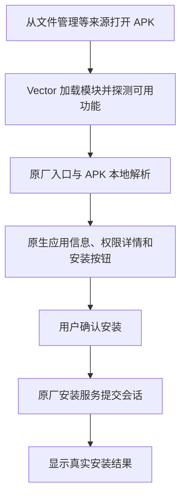

# ColorOS17安装器净化

**ColorOS17安装器净化 1.1** 是用于 Vector 的应用安装器模块。它保留 `com.oplus.appdetail` 的原生全屏安装界面、应用信息和权限详情，精简厂商扫描、广告、更新提醒及重复确认，让安装过程集中在查看信息和确认安装上。

模块使用现代 libxposed API 102，按目标应用的实际代码结构选择可用功能，桌面入口隐藏。

## 功能

- **原生安装确认**：使用安装器原有的全屏页面、应用信息和“安装”按钮，沿用原厂安装监听、导航和安装服务。
- **扫描与提示精简**：跳过匹配的厂商风险扫描和验证引导，隐藏扫描失败卡片、重复扫描及相关确认提示。
- **推荐与提醒处理**：处理广告推荐、商店引导、深度检测推广、安装器自身更新及游戏更新提醒等可选入口。
- **本地权限展示**：从 APK 本地解析结果读取权限，提供权限数量和原生详情页。
- **真实安装结果**：完成页显示系统返回的成功或失败结果，保留原厂安装记账和必要的32位兼容处理。
- **按项自动适配**：各功能分别检查依赖，匹配的功能启用，未匹配或存在歧义的功能保持原厂行为。

这些功能以对应结构匹配成功为前提。Android 的签名校验、来源授权、安装会话校验和真实安装错误由系统处理；模块不会自动确认安装、授予权限或伪造安装成功。跳过风险扫描后的页面状态也不代表 APK 已通过安全检测。

## 权限详情

权限详情使用安装器原生 `PermissionActivity` 和列表样式，按以下顺序显示：

| 分类 | 归类方式 |
| --- | --- |
| 敏感权限 | 原厂标记为敏感，或系统元数据的基础保护级别为 `dangerous` 的权限，优先归入此组 |
| 普通权限 | 其余由 Android 平台或系统应用定义的权限；这是展示分类，不代表权限已授予或没有风险 |
| 自定义权限 | 其余由第三方应用定义，或当前系统无法识别的权限 |

空分类自动隐藏，每组独立编号，组内保留 APK 的声明顺序。权限数量和详情使用同一份去重后的权限集合。

能够读取的名称和说明分别保留。缺失名称时显示原始权限名，缺少说明时显示中性说明；信息缺失不会导致条目被丢弃。若无法读取 APK 的权限元数据，权限区域会隐藏，避免将未知状态显示为“0 项权限”。

## 工作原理

模块在目标进程加载后，通过 Vector 注册 Java 方法钩子，调整可选功能和页面状态。作用范围包括应用安装器前端 `com.oplus.appdetail`，以及系统安装入口 `com.android.packageinstaller`。

### 结构探测

`StructuralProbe` 对照内置模板核对类、完整方法参数、返回类型、静态或实例属性、字段类型、构造方法和去优化调用者。探测只读取代码声明，不执行目标方法、调用构造函数或初始化静态单例。

安装器版本号仅用于诊断日志。是否启用功能由实际结构决定，不使用版本白名单。

| 功能组 | 启用条件 |
| --- | --- |
| 安装引导、扫描状态与原生安装按钮 | 整套依赖匹配，保证页面和状态能够衔接 |
| 权限摘要及三类详情 | 安装流程组匹配后，再核对同一模板中的权限页依赖 |
| 推荐、结果页、结果弹窗、更新提醒、取消提示、完成页提示 | 按功能独立探测、注册和回滚 |

完全相同的模板只启用一次。若一个候选完整包含另一个候选的相同规则并提供额外接口，会选择该兼容超集；若多个候选互不包含，视为歧义并跳过。缺失依赖或注册失败只影响对应功能组，其他独立匹配的功能可以继续使用。

### 安装流程

安装流程组匹配时，模块使用本地精简引导配置，衔接原生确认页和安装服务。APK 的暂存、解析及真正的安装会话仍由原厂处理。



`InstallerHook` 调整预加载引导、扫描状态、原生按钮和可选推荐入口。安装按钮沿用原厂监听和导航，完成页保留安装状态处理。

`NativeRouter` 核对底层入口结构，仅在安装分支且原返回值为已知的功能开关回退状态时，检查前端 APK 的完整安装流程模板。唯一匹配后才调整入口状态；其他返回值、前端不匹配及卸载分支保持原语义。探测结果按 APK 路径和文件更新时间缓存，APK 变化时重新检查。

模块对目标方法和指定调用者执行去优化，减少已编译代码中的方法内联绕过钩子的情况。整个实现通过进程内钩子工作，不重签或替换原厂 APK，也不修改 `system_server`。

### 模块重载

模块支持 API 102 自动重载回调。旧代码仅传递目标包名、原厂 ClassLoader 和用于诊断的安装器版本；新代码重新探测依赖、卸载旧钩子并注册可用功能。日志包含实际加载代码的内部版本码和构建标识，可以区分安装文件与进程中的代码。

自动重载需要 Vector 接收到包更新并刷新缓存。若覆盖安装后仍显示旧效果，在 Vector 中关闭再开启本模块，然后结束并重新打开两个安装器进程。

## 适配与验证范围

项目面向 ColorOS 17 安装器环境，内置两套结构模板。模板来源版本是参考样本，不是运行白名单。

| 参考样本 | 验证范围 |
| --- | --- |
| `com.oplus.appdetail` 5.17.62_os17（51762） | DEX 结构矩阵和手机只读反射均匹配33个钩子；当前设备已验证功能组启用和三类权限详情 |
| `com.oplus.appdetail` 5.23.0（52302） | DEX 结构矩阵和手机隔离 ClassLoader 只读反射均匹配33个钩子；未安装此样本验证完整流程 |
| `com.android.packageinstaller` 17.0.1（17000001） | 入口结构与当前设备的钩子启用已验证 |
| 其他安装器版本 | 按功能探测实际结构，未匹配的功能保持原厂行为 |

结构相同的其他版本可以沿用模板；混淆类名、方法语义或页面流程大幅变化时，需要补充模板。结构匹配通过只表示具备挂载条件，不能替代完整安装流程验证。

本地回归检查包含76项断言，覆盖权限完整性与分类、解析兼容状态、重载状态交接、签名不符、依赖缺失、模板歧义和路由分支。验证范围不包含当前构建的实际应用安装流程，也不包含未知版本的完整行为验证。

## 安装与使用

1. 安装模块 APK，可使用本地构建产物或[项目发布页](https://github.com/AstriaFR/ColorOS17-InstallerClean/releases)提供的安装包。
2. 在 Vector 中启用 **ColorOS17安装器净化**。
3. 作用域选择 `com.oplus.appdetail` 和 `com.android.packageinstaller`。
4. 结束安装器进程后，重新打开需要安装的 APK。

模块版本为 **1.1**，包名为 `cn.lzy.gt7p.installerclean`，没有桌面入口。启用状态和作用域在 Vector 中管理。

### 本地更新

仓库提供 [install-local.ps1](install-local.ps1)，用于通过 ADB 覆盖安装和刷新 Vector 缓存。脚本要求设备已授权 USB 调试、可使用 `su`，且本模块已在 Vector 中启用并配置作用域。

```powershell
./install-local.ps1 -Apk ./ColorOS17-InstallerClean-v1.1.apk -Adb /path/to/adb -ExpectedVersionCode 120
```

脚本仅重新启用本模块以刷新缓存，再结束两个安装器进程；同时核对安装包哈希、版本码、模块状态和原有作用域。它不执行应用安装流程，也不重启手机。

## 源码与构建

| 文件 | 职责 |
| --- | --- |
| `InstallerHook.java`、`NativeRouter.java` | 前端功能钩子与底层安装入口 |
| `StructuralProbe.java`、`Feature.java`、`profile.json` | 结构匹配、功能分组与模板定义 |
| `PermissionPanel.java`、`PermissionCatalog.java`、`PermissionDetails.java` | 本地权限数据、分类与原生详情页 |
| `ParsingPolicy.java`、`RoutingPolicy.java` | 解析兼容状态和安装入口分支策略 |
| `ReloadState.java`、`BuildInfo.java` | 重载状态交接与实际代码版本标识 |
| `verify_profile.py`、`profile_generator.py` | 原厂 DEX 校验、模板生成和结构匹配矩阵 |

构建需要 JDK 17+、Android SDK Platform 37、Build Tools 37.0.0，以及 libxposed API 102.0.0 AAR。

```powershell
./build.ps1 -Sdk /path/to/android-sdk -Jdk /path/to/jdk -LibXposedAar /path/to/api-102.0.0.aar
```

默认生成 `build/apk/ColorOS17-InstallerClean-v1.1-unsigned.apk`。指定签名参数后生成 `ColorOS17-InstallerClean-v1.1.apk`，签名参数见构建脚本。生成的 `Profile.java` 已包含在源码中，普通构建无需原厂 APK。

对照本地原厂 APK 校验或重新生成模板时，需要按 `profile.json` 放置参考文件，并安装 `requirements.txt` 中的依赖，然后运行：

```powershell
python ./verify_profile.py
```

本地回归检查不连接手机：

```powershell
./tests/run-local.ps1 -Jdk /path/to/jdk
```

原厂 APK、签名私钥及设备日志不随源码分发。
